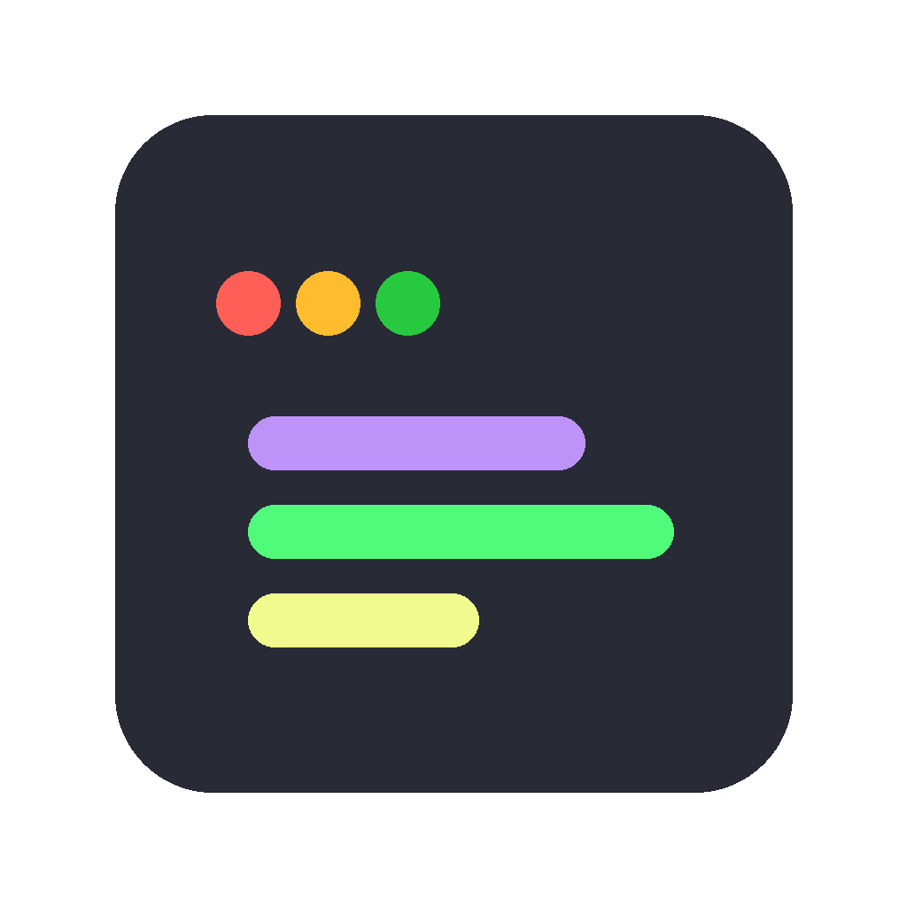
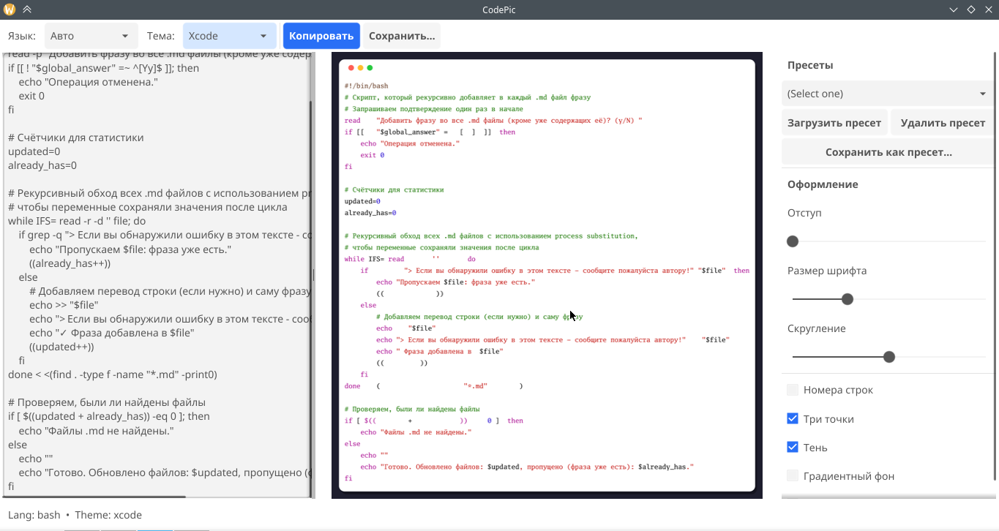

### 📄 `README.md`

# CodePic

[](https://github.com/rurewa/codepic-app/releases)
[](LICENSE)
[](https://go.dev/)
[](https://fyne.io/)
[]()

<p align="center">
  
</p>

<p align="center">
  <strong>Локальный скриншотер кода для мессенджеров и документов.</strong><br>
  100% local · никакой телеметрии · никаких сетевых запросов
</p>

---

**CodePic** превращает фрагмент кода в красивую картинку и кладёт её в буфер обмена — готово для вставки в Telegram, Slack, Discord, документ или презентацию. Вдохновлён [Codeshot](https://www.codeshot.app/), но распространяется бесплатно, работает на Linux и Windows, и весь код остаётся у вас на компьютере.

## 📸 Скриншот



## ✨ Особенности

- 🔒 **100% локально** — код не покидает ваш компьютер, ни одного сетевого запроса.
- 🎨 **15+ тем подсветки** — Dracula, Monokai, Nord, Solarized, GitHub и другие (на базе Chroma).
- 🧠 **Автоопределение языка** — более 16 популярных языков, включая Go, Python, Rust, TypeScript, SQL и Bash.
- 🎛 **Гибкое оформление** — отступы, скругления, размер шрифта, номера строк, тень, градиент и прозрачный фон.
- 📋 **Копирование в один клик** — готовый PNG сразу в буфере обмена.
- 💾 **Пресеты** — сохранение и загрузка комбинаций «тема + оформление».
- 📦 **Статический бинарник** — Linux-сборка не зависит от glibc (musl).
- 🖥 **Кроссплатформенность** — Linux и Windows, GUI и CLI.

## 📦 Установка

Скачайте нужный файл со [страницы релизов](https://github.com/rurewa/codepic-app/releases).

### Debian / Ubuntu / Mint

```bash
sudo apt install ./codepic-linux-amd64.deb
```

### Fedora / RHEL / openSUSE / ALT Linux

```bash
sudo dnf install ./codepic-linux-amd64.rpm
# или
sudo rpm -i ./codepic-linux-amd64.rpm
```

### Любой Linux, без установки

```bash
tar -xf codepic-linux-amd64.tar.xz
chmod +x codepic
./codepic
```

> **Wayland**: для копирования в буфер обмена требуется `wl-clipboard`.
> Установка: `sudo apt install wl-clipboard` (Debian/Ubuntu), `sudo pacman -S wl-clipboard` (Arch), `sudo dnf install wl-clipboard` (Fedora/ALT).

### Windows

Скачайте `codepic-windows-amd64.zip`, распакуйте, запустите `codepic.exe`.

> ⚠️ Подписи кода нет, поэтому SmartScreen может показать предупреждение при первом запуске — «Подробнее» → «Выполнить в любом случае».

## 🖥 Использование GUI

1. Вставьте код в левую панель.
2. Выберите язык (по умолчанию — «Авто») и тему.
3. Настройте оформление в правой панели: отступы, шрифт, скругления, номера строк, тень, градиент, прозрачность.
4. Нажмите **«Копировать»** — картинка окажется в буфере обмена.
5. Или **«Сохранить…»** — чтобы сохранить PNG в файл.

Настройки и последний загруженный пресет сохраняются в:

- **Linux**: `~/.config/codepic/config.json`
- **Windows**: `%AppData%\codepic\config.json`

## ⌨️ Использование CLI (`codepic-cli`)

CLI-версия — это тот же движок без графики. Работает в терминале, в SSH-сессии, в CI, в TTY-контейнере. Идеальна для скриптов, генерации картинок для документации и проверки ядра при разработке.

### Установка

`codepic-cli` лежит в релизе отдельным файлом:

- **Linux**: `codepic-cli-linux-amd64` (статический, без зависимостей).
- **Windows**: `codepic-cli-windows-amd64.exe`.

```bash
# Linux
chmod +x codepic-cli-linux-amd64
./codepic-cli-linux-amd64 --help

# Windows
codepic-cli-windows-amd64.exe --help
```

Для удобства можно переименовать в `codepic-cli` и положить в `$PATH`.

### Базовые примеры

```bash
# Встроенный пример кода, стиль по умолчанию → out.png
./codepic-cli

# Реальный файл + конкретная тема
./codepic-cli --theme nord cmd/codepic/main.go

# Другое имя выходного файла
./codepic-cli --out result.png --theme dracula internal/render/render.go

# Явно указать язык (если автоопределение ошибается)
./codepic-cli --lang go --theme monokai main.go

# Скопировать сразу в буфер обмена (плюс сохранить PNG)
./codepic-cli --copy --theme gruvbox main.go
```

### Пресеты

```bash
# Сохранить текущий стиль под именем
./codepic-cli --theme monokai --save-preset my-mk
# → preset "my-mk" saved (~/.config/codepic/config.json)

# Посмотреть список сохранённых пресетов
./codepic-cli --list-presets
# → my-mk

# Загрузить пресет и собрать картинку
./codepic-cli --preset my-mk --out mk.png

# Удалить — через редактирование config.json или GUI (в CLI пока нет --remove-preset)
```

### Просмотр доступных тем

```bash
./codepic-cli --list-themes
# dracula          Dracula
# emacs            Emacs
# github           GitHub Light
# gruvbox          Gruvbox Dark
# monokai          Monokai
# nord             Nord
# solarized-dark   Solarized Dark
# ...
```

### Все флаги

| Флаг | По умолчанию | Описание |
| :--- | :--- | :--- |
| `-out FILE` | `out.png` | Путь к выходному PNG |
| `-lang LANG` | `auto` | Язык (`auto`, `go`, `python`, …) |
| `-theme ID` | из конфига | ID темы (`dracula`, `nord`, …) |
| `-preset NAME` | — | Загрузить стиль из пресета |
| `-save-preset NAME` | — | Сохранить текущий стиль как пресет |
| `-list-presets` | — | Показать пресеты и выйти |
| `-list-themes` | — | Показать темы и выйти |
| `-copy` | `false` | Скопировать PNG в буфер обмена |
| `-h` | — | Справка |

### Буфер обмена в CLI

- **Linux + X11**: работает из коробки.
- **Linux + Wayland**: нужен `wl-clipboard` (команда `wl-copy`). Без него CLI не упадёт — напишет `warning: clipboard unavailable`, но PNG сохранит.
- **Windows**: работает из коробки.
- **TTY без графики**: `--copy` выдаст `warning`, PNG всё равно сохранится.

```bash
# Проверить сессию
echo $XDG_SESSION_TYPE   # → x11, wayland или tty

# Установить wl-clipboard для Wayland
sudo apt install wl-clipboard
```

### Проверка, что CLI — статический

```bash
ldd ./codepic-cli
# → not a dynamic executable
```

Это значит, что бинарник не зависит от glibc и запустится на любом Linux-дистрибутиве.

## 🛠 Сборка из исходников

**Требования:** Go 1.26+, для GUI — системные библиотеки Fyne (X11/OpenGL, `libgl1-mesa-dev`, `xorg-dev` на Debian/Ubuntu).

```bash
git clone https://github.com/rurewa/codepic-app.git
cd codepic-app

# CLI (без CGO, быстро)
CGO_ENABLED=0 go build -o codepic-cli ./cmd/codepic-cli

# GUI (требует CGO и системных библиотек)
go build -o codepic ./cmd/codepic
```

### Релизная сборка (статический musl, без glibc)

```bash
fyne-cross linux \
  -arch=amd64 \
  -icon assets/icons/icon.png \
  -app-id io.github.rurewa.codepic \
  -name codepic \
  -ldflags=-s -ldflags=-w \
  ./cmd/codepic
```

Артефакты появятся в `fyne-cross/dist/linux-amd64/`. Windows-сборка — замените `linux` на `windows`.

### Иконки

Иконки генерируются скриптом `tools/genicon.py` (требуется Pillow):

```bash
python3 tools/genicon.py
# → assets/icons/icon.png, icon.ico, hicolor/*.png
```

## 📄 Лицензия

Проект распространяется под лицензией **MIT**. См. [LICENSE](LICENSE).

## 🙏 Благодарности

- [Fyne](https://fyne.io/) — кроссплатформенный GUI-фреймворк на Go.
- [Chroma](https://github.com/alecthomas/chroma) — подсветка синтаксиса для 200+ языков.
- [fyne-cross](https://github.com/fyne-io/fyne-cross) — статическая и кросс-платформенная сборка.
- [nFPM](https://nfpm.goreleaser.com/) — сборка `.deb` и `.rpm`.
- [Codeshot](https://www.codeshot.app/) — вдохновение и референс UX.
- AI-ассистенты **DeepSeek AI** и **Qwen3.8-Max** — помощь в разработке.

## 🗺 Дорожная карта

- [x] Релиз v1.0.0 — Linux (static musl) и Windows
- [x] CI/CD: GitHub Actions + `fyne-cross`, `.deb`, `.rpm`
- [x] Пресеты оформления
- [x] Сохранение последнего стиля и языка
- [x] Прозрачный фон
- [ ] Собственный шрифт (JetBrains Mono) вместо встроенного `gomono`
- [ ] Color picker для фона и градиента
- [ ] AppImage
- [ ] Подсветка кода в редакторе (предпросмотр `TextGrid`)

---

Есть идеи или нашли баг? Создавайте [Issue](https://github.com/rurewa/codepic-app/issues) или присылайте Pull Request.