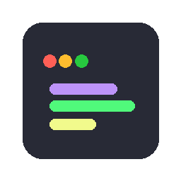

# CodePic

[](https://github.com/USER/REPO/actions/workflows/ci.yml)
[](LICENSE)
[](https://go.dev/)
[](https://fyne.io/)

<p align="center">
  
</p>

Локальный скриншотер кода для мессенджеров. 100% local, no cloud.

> ⚠️ В активной разработке. Первый релиз — скоро.

## Стек
- Go + Fyne (GUI)
- Chroma (подсветка синтаксиса)
- Linux (static musl) и Windows

**CodePic** - приложение для скриншота кода - аналог Codeshot. Полностью нативное, не требует интернета (код никуда не отправляется), поддерживает несколько тем.

**Как это работает:** Вы вставляете код, выбираете тему, оформление и отступы. а затем нажимаете кнопку "Копировать", готовое изображение в буфер обмена и его можно сразу вставить в любой мессенджер или документ.

## 📸 Скриншоты


## 📦 Установка

Скачайте нужный файл из [Releases](https://github.com/rurewa/codepic-app/releases).

### ALT Linux
```shell
apt-get install hex-loader_0.1.0_amd64.deb
```
### Debian / Ubuntu / Mint
```bash
sudo apt install ./hex-loader_0.1.0_amd64.deb
```
### Fedora / RHEL / openSUSE
```bash
sudo dnf install ./hex-loader-0.1.0.x86_64.rpm
```
или
```bash
sudo rpm -i ./hex-loader-0.1.0.x86_64.rpm
```
### AppImage (любой дистрибутив Linux, без установки)
```bash
chmod +x Hex_Loader-v0.1.0-x86_64.AppImage
./Hex_Loader-v0.1.0-x86_64.AppImage
```

### Проверка CLI

#### Из исходников

```shell
cd codepic-app/
```
Без аргументов — встроенный пример, дефолтный стиль
```shell
go run ./cmd/codepic-cli
```
Реальный файл + тема
```shell
go run ./cmd/codepic-cli --theme nord cmd/codepic-cli/main.go
```
Сохранить пресет
```shell
go run ./cmd/codepic-cli --theme monokai --save-preset my-mk
```
→ preset "my-mk" saved (/home/you/.config/codepic/config.json)

Список пресетов
```shell
go run ./cmd/codepic-cli --list-presets
```
→ my-mk

Загрузить пресет
```shell
go run ./cmd/codepic-cli --preset my-mk --out mk.png
```
--copy без файла теперь тоже работает
```shell
go run ./cmd/codepic-cli --copy
```
(в TTY — warning про clipboard, PNG сохранён)

#### Бинарником

# Из TTY-контейнера:
./codepic-cli --list-themes
./codepic-cli --theme nord cmd/codepic/main.go
./codepic-cli --copy cmd/codepic/main.go
# → warning: clipboard unavailable...  (ожидаемо в TTY)

# Заодно убедитесь, что CLI остался статическим:
ldd ./codepic-cli
# → not a dynamic executable

## 📄 Лицензия

Проект распространяется под лицензией **MIT**. См. [LICENSE](LICENSE).

## 🙏 Благодарности

- [Fyne](https://fyne.io/) — кроссплатформенный GUI-фреймворк.
- [Arduino CLI](https://github.com/arduino/arduino-cli) — работа с платами и загрузка.
- [nFPM](https://nfpm.goreleaser.com/) — сборка `.deb` и `.rpm`.
- [appimagetool](https://github.com/AppImage/appimagetool) — сборка AppImage.
- AI-ассистенты **DeepSeek AI** и **Qwen3.8-Max** — помощь в разработке.

Есть идеи или нашли баг? Создавайте [Issue](https://github.com/rurewa/codepic-app/issues) или присылайте Pull Request.

#### ToDo

- [ ] Надо ли сохранить папку fyne-cross со всем её содержимым?
- [ ] Подсветка кода в редакторе
- [ ] CI/CD — пайплайн с fyne-cross, артефакты для Linux и Windows - релиз v0.1.0
- [ ] Окончательный README со скриншотами

